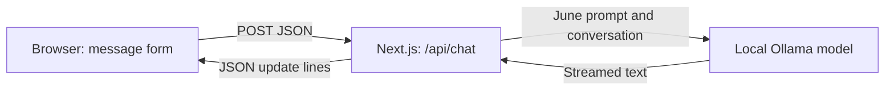

# June v0.1

A personal text assistant, built one phase at a time. June now has a React/Next.js chat screen, a June system prompt and real streamed replies from a small local model.

**Open locally:** <http://127.0.0.1:3001>

Qwen3 0.6B is an existing pretrained model running through Ollama on your Intel Mac's CPU. This phase builds the assistant around it; it does not train a new model. Voice, saved memory and computer actions follow later phases.

## Start and stop June

Open two terminals in this folder. In the first, start the model server:

```sh
cd /Users/apple/Documents/June
npm run model:start
```

In the second, start June's web app:

```sh
cd /Users/apple/Documents/June
npm start
```

Open <http://127.0.0.1:3001>. The status should show **qwen3:0.6b · Ready**. Your Mac and both processes must stay running. Press **Control+C** in each terminal to stop them. Nothing starts automatically at login. Port 3001 is intentional: Mad Realm uses 3000.

## First setup or another Mac

Use a recent Node.js release (22 or 24 LTS recommended; this machine uses Node 23.7). From the project folder:

```sh
npm install
cp .env.example .env.local
```

Install [Ollama from its official source](https://ollama.com/download). The helper uses June's private runtime at `~/Library/Application Support/June/runtime/ollama` if present; otherwise it uses `ollama` in your PATH. This machine has the official universal macOS CLI release **0.40.2**, including Intel support, installed in that runtime folder.

Start `npm run model:start`. While it runs, use a second terminal:

```sh
npm run model:pull
npm run build
npm start
```

The model download is about 523 MB. June's helper stores models in `~/Library/Application Support/June/models`, disables Ollama cloud inference and binds the server to the local computer. No API key, account, GPU purchase or paid service is needed. Internet is needed for downloads; inference runs locally after setup.

## Chat controls and limits

- **Send** or **Enter** submits once; **Shift+Enter** inserts a newline.
- **Stop** interrupts a reply. Partial text stays visible and labelled stopped.
- **New chat** clears the conversation and model context.
- **Reconnect** checks the model server after a restart.
- **Practice demo** is a manually selected learning mode with simulated replies. It is clearly labelled and never selected automatically on failure.

Only completed message/reply pairs become follow-up context. Failed and interrupted turns stay visible but are excluded; on failure your input is restored for retry. Switching reply source starts a new chat. Refreshing clears messages. There is no database, local-storage chat history or cross-session memory.

Messages are limited to 2,000 characters; a request may contain up to 20 messages and 6,000 characters of conversation text. June asks you to start a new chat when the limit is reached rather than quietly forgetting text. Generation uses a 4,096-token context, a 256-token reply cap, temperature 0.6 and thinking disabled. A small model can answer incorrectly; long answers can hit the reply cap.

## Edit and learn — Phase 1 order

Use `npm run dev` while editing; changes refresh automatically. Stop the production server first to free the port. Before returning to `npm start`, stop development and run `npm run build` again.

| Topic | Code to study | What to explain |
|---|---|---|
| async/await and fetch | `components/Chat.tsx` | Waiting, streamed updates and error recovery. |
| JSON | `lib/chat-types.ts`, `lib/ndjson.ts` | Roles/text become JSON; network chunks need buffering. |
| TypeScript | Shared message and event types | Compile-time mistakes versus runtime validation. |
| React and Next.js | Chat component and `app/api/` routes | State updates the screen; browser and server have different jobs. |
| Environment variables | `.env.example`, model adapter | Configuration stays on the server, outside Git and browser bundles. |
| AI basics | June's prompt and Ollama adapter | System prompt, tokens, context, temperature and streaming. |
| Free first prototype | Demo and Ollama adapters | Simulated learning replies versus real model output. |

The Phase 0 HTML/CSS files remain available as a refresher. This phase project uses React, Next.js and TypeScript, matching the workbook's order.

## One message's journey



1. The form creates a user message; a busy guard prevents duplicate sends.
2. The chat route validates JSON, roles and limits, then adds June's server-owned prompt.
3. The selected adapter calls the model and produces `delta`, `done` or `error` events.
4. The browser decodes update lines and appends text to one reply. React renders ordinary text, never executable HTML.
5. Stop or New chat cancels the browser and model requests. Only completed replies become context.

### Local interfaces

- `GET /api/status` returns `{ state, model, message }`; state is `ready`, `offline`, `missing` or `error`.
- `POST /api/chat` accepts `{ mode: "local" | "demo", messages: [{ role: "user" | "assistant", content: "..." }] }`.
- Successful requests stream `application/x-ndjson`: `{ type: "delta", text }`, `{ type: "done", model }` or `{ type: "error", message }`.
- Invalid input returns HTTP 400; an unavailable model returns 503. Failures during streaming use error events. Cross-origin browser requests are rejected.

Both servers bind to loopback. Remote hosting and authentication are later work.

## Troubleshooting

**Ollama offline:** run `npm run model:start`, then Reconnect.

**Model missing:** leave the server running, run `npm run model:pull`, then Reconnect.

**June's server unavailable:** restart `npm start`; rebuild if you edited the app.

**Slow reply:** the first reply may load the model. Try a short question. Timing below the input reports first text and total duration; Stop cancels. Requests time out after three minutes.

**Conversation too long:** use New chat. Persistent memory is a later phase.

## Verify and save changes

```sh
npm run typecheck
npm run build
git diff
git add app components lib scripts package.json package-lock.json tsconfig.json next.config.ts .env.example .gitignore README.md docs
git commit -m "Build June v0.1 local AI chat"
```

Manual checks: empty input, Enter/Shift+Enter, wrapping, safe `<script>` text, genuine streaming, follow-up context, cancellation, context clearing, and recovery from a stopped model server. See `docs/verification.md` for this run's results.

## Phase 0 and the public site

The existing `index.html` and `styles.css` are preserved. [GitHub Pages](https://shivaxsh.github.io/june/) still publishes v0.0 from **main / root**. June v0.1 is on **codex/june-v0.1**, runs locally and is not the Pages publishing branch. [Source repository](https://github.com/Shivaxsh/june).

Keep `.env.local`, models, screenshots, progress backups and private personality notes out of public Git commits.
