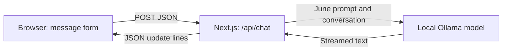

# June v0.5.1

A personal assistant, built one phase at a time. June combines a Python backend, local streamed text chat, a Canvas particle orb, local Whisper speech recognition and a local female speaking voice.

**Phase 6:** [Memory and personality walkthrough](docs/phase-6.md) · [learning studio](http://127.0.0.1:3001/learn/phase-6). Private SQLite history (30 days), approved facts, editable character profile and reviewed JSON import/export. This is application memory, not model training.

**Phase 5:** [Hands-free walkthrough](docs/phase-5.md) · [learning studio](http://127.0.0.1:3001/learn/phase-5). Explicit microphone enablement, local “Hey June” activation, natural speech interruption, automatic question sending and 30-second follow-ups. [Voice repair notes](docs/voice-interruption-repair.md). Run `npm run realtime:setup` once; microphone conversation verification remains a separate completion gate.

**Phase 4:** [Python walkthrough and source map](docs/phase-4.md) · [learning studio](http://127.0.0.1:3001/learn/phase-4). The backend migration preserves the existing chat and local voice flow.

**Open locally:** <http://127.0.0.1:3001>

Qwen2.5 1.5B is an existing pretrained model running through Ollama on your Intel Mac's CPU. This phase builds the assistant around it; it does not train a new model. Memory and personality are available locally with approval controls. Computer/account actions follow later phases.

## Start and stop June

Open two terminals in this folder. In the first, start the model server:

```sh
cd /Users/apple/Documents/June
npm run model:start
```

In the second, start June's Python backend and web app together:

```sh
cd /Users/apple/Documents/June
npm start
```

Open <http://127.0.0.1:3001>. The status should show **qwen2.5:1.5b · Ready**. Your Mac and the processes must stay running. Press **Control+C** in each terminal to stop them. June stops only processes it started; a separately started Python backend is left running. Nothing starts automatically at login. Port 3001 is intentional: Mad Realm uses 3000. Python uses local port 8001.

**v0.5.1:** [Local audio and reliability guide](docs/v0.5.1.md) · [verification and remaining limitations](docs/v0.5.1-verification.md). Native Mac capture and Nicky playback share an echo-processing engine; the resident Whisper worker avoids loading the model for each recording. Native microphone permission is separate from the browser permission. Speaker-room acceptance remains a human verification gate.

**Before the next phase:** [Reliability acceptance gate](docs/reliability-gate-2026-10-31.md). The opt-in `PYTHONPATH=backend backend/.venv/bin/python scripts/check-reliability.py` command tests real local Qwen with a private SQLite clone. It never edits the live database or opens a microphone. Its ignored reports contain private reply text; do not publish them.

That standalone Python command uses exported `JUNE_*`/`OLLAMA_BASE_URL` environment variables and the documented default directories. If your private `.env.local` uses overrides, export those same overrides in the terminal before running the check.

## First setup or another Mac

Use a recent Node.js release (22 or 24 LTS recommended; this machine uses Node 23.7). From the project folder:

```sh
npm install
cp .env.example .env.local
npm run backend:setup
```

Install [Ollama from its official source](https://ollama.com/download). The helper uses June's private runtime at `~/Library/Application Support/June/runtime/ollama` if present; otherwise it uses `ollama` in your PATH. This machine has the official universal macOS CLI release **0.40.2**, including Intel support, installed in that runtime folder.

Start `npm run model:start`. While it runs, use a second terminal:

```sh
npm run model:pull
npm run speech:setup
npm run audio:setup
npm run build
npm start
```

The model download is about 986 MB. June's helper stores models in `~/Library/Application Support/June/models`, disables Ollama cloud inference and binds the server to the local computer. No API key, account, GPU purchase or paid service is needed. Internet is needed for downloads; inference runs locally after setup.

## Chat controls and limits

- **Send** or **Enter** submits once; **Shift+Enter** inserts a newline.
- **Stop** interrupts a reply. Partial text stays visible and labelled stopped.
- **New chat** starts a separate conversation and clears active model context; earlier chats remain in Recent chats.
- **Reconnect** checks the model server after a restart.
- **Practice demo** is a manually selected learning mode with simulated replies. It is clearly labelled and never selected automatically on failure.

Only completed message/reply pairs become follow-up context. Failed and interrupted turns stay visible but are excluded; on failure your input is restored for retry. Switching reply source starts a new chat. Reloading clears the active view, but saved conversations remain in Recent chats for 30 days. Approved memories persist separately in private SQLite storage on this Mac; merely mentioning a fact does not approve it.

Messages are limited to 2,000 characters; a request may contain up to 20 messages and 6,000 characters of conversation text. The app keeps recent whole turns within that request budget and shows a notice when older context is shortened. Older messages stay visible; this is not saved memory. Oversized historical replies are shortened only in the model context, with Unicode characters kept intact. Generation uses a 4,096-token context, a 256-token reply cap, temperature 0.1 and thinking disabled. A small model can answer incorrectly or repeat earlier errors even after a correction; this is not fixed by lowering temperature alone. Long answers can hit the reply cap; these are labelled, and only complete sentences are automatically spoken. See [the reliability audit](docs/reliability-audit.md).

## Phase 3 — talk and hear June

June records the microphone directly, then uses local Whisper **base.en** to turn the recording into English text. Qwen writes the reply and a local female system voice reads it aloud. No external recognition service, paid provider or API key is used. Your recording reaches only June's server on this Mac and its temporary file is deleted after processing.

1. Choose and preview June's voice. Known female local English identities are offered; Indian English is preferred when available. This Mac/browser currently offers Samantha (American English) and other female English voices, but no recognised female Indian English voice.
2. Hold **Hold to talk** with mouse/touch, or hold Space/Enter while it is focused. Release ends recording and starts transcription. Limit: 30 seconds; review appears after processing, not live while you speak. **Start listening / Stop listening** is a toggle alternative for accessibility.
3. Review and edit the transcript. **Use transcript** appends it to any existing draft; **Send** is deliberately separate. If the combined text exceeds the message limit, shorten it before using it.
4. Every reply is spoken by default. **Speak replies** saves your mute preference. Voice selection also survives reload; input is English for every accent, and old browser-recognition language settings are no longer used; transcripts remain temporary; saved chats stay in Recent chats for 30 days.
5. **Stop** cancels the model, recognition and speech. **Stop voice** clears current and queued speech while allowing text generation to continue. **Hear reply** replays a completed answer even when automatic speech is muted.

Streaming text becomes speech one sentence at a time. Fenced code blocks are excluded; formatting markers are removed, while the full written reply stays visible. Sentence ordering and request identifiers keep cancelled or superseded speech from returning later.

Actual listening and speaking control the orb. Speech boundary events highlight words when supported; otherwise captions use approximate timing. Speech movement is explicitly a visual approximation. Browser system synthesis does not expose audio samples for the sound meter, so amplitude is labelled unavailable during speech. Phase 2 sample/file visualisation still uses actual measured sound.

Voice activities and the Phase 2 audio sources operate exclusively. Starting recognition stops speech/audio; starting sample/file playback stops recognition and suppresses the current reply's speech queue. New chat, navigation and hidden tabs stop media work. Recognition controls are disabled during model generation.

Open the [Phase 3 studio](http://127.0.0.1:3001/learn/phase-3) for the six workbook topics, preview controls and an explicitly labelled sentence-streaming demonstration. It never sends demonstration text to the model. The detailed walkthrough is `docs/phase-3.md`.

### Speech setup and recovery

Run `npm run speech:setup` once. It installs pinned whisper.cpp v1.9.5, a private CMake 3.31.6 environment and base.en (about 142 MiB), compiles a CPU-only engine, verifies the model SHA-256 and runs a genuine speech smoke test. Existing Apple command-line compiler tools and Python 3 are required; this Mac already has both. Files stay under `~/Library/Application Support/June/speech`, outside Git. Internet is needed only for setup downloads.

Use `npm run speech:check` to verify the installation. June's **Refresh speech** checks server readiness. There is no third server to start: June’s Python backend launches the speech engine when you finish a recording. Two CPU threads and a two-minute timeout keep jobs bounded. Stop aborts the job and removes temporary recordings. Quiet or very short recordings show a retry message. Whisper can mishear speech and background noise; always review the words.

The 11-second official reference clip took about 2.5 seconds to transcribe on this Intel Mac during initial verification. This is an observed example, not a latency guarantee. See `docs/verification-v0.3.1.md` for the physical conversation acceptance result.


## Phase 2 — explore her face

Open **Sound & microphone** on the chat page. Play the original 18-second June tones sample, choose a local audio file, or explicitly start the microphone. The microphone only measures sound; it does not understand words, save recordings or send sound to the model. Microphone input is never played through the speakers.

- **Auto** follows actual activity. A model request takes visual priority; the sound controls still report their independent state.
- **Idle / Listening / Thinking / Speaking** are labelled visual previews. Sending a message exits preview mode.
- **Still view**, or your system's reduced-motion preference, freezes the network while keeping activity labels and the sound meter.
- **Pause audio** preserves playback position; **Stop audio** releases the source. Starting another source releases the previous one.
- **New chat**, leaving the page or hiding the tab stops sound and microphone input. Nothing starts automatically on return.
- Microphone permission requests time out after 30 seconds. Stop also cancels a pending request logically; a later permission grant immediately releases the newly returned tracks.
- A selected audio file stays in browser memory for this page only. Its temporary object URL is released on Stop or source replacement.

The [learning studio](http://127.0.0.1:3001/learn/phase-2) follows the workbook's exact topic order: Canvas, Three.js, Web Audio, GLSL shaders, moods, optional React Three Fiber. One example is active at a time. Exploring these examples does not tick learning checkboxes.

### How the animation works

1. `components/orb/Orb.tsx` creates 110 repeatable points and projects them onto a 2D canvas. Nearby points get lines; small moving dots represent travelling signals.
2. One animation loop redraws at approximately 30 frames per second, with drawing resolution capped to reduce work. React does not rerender for each sound reading.
3. `lib/orb/audio-controller.ts` owns one AudioContext and source. An AnalyserNode reads the waveform, calculates RMS amplitude and smooths it into a value from zero to one.
4. The renderer reads that shared value to change radius and glow. The meter shows the same measured signal. Manual moods never invent audio measurements.
5. `lib/orb/state.ts` resolves generation, preview and audio state into an appearance and an honest label. The existing chat API contracts are unchanged.

Three.js is a separate, dynamically loaded learning example in `components/orb/GraphicsDemo.tsx`. Its geometry, material and renderer are disposed on topic changes. The shader example uses GLSL for colour and glow; the ordinary CSS fallback remains available without WebGL. React Three Fiber is explained as optional and is not installed.

The original standalone circle exercise in `../June-Canvas-Practice` remains available.

### Sound troubleshooting

If microphone permission stays pending, check your browser's permission prompt. If the embedded browser cannot provide microphone access, open June's same local URL in a browser that supports it. Denial, missing devices and unsupported files display a message while text chat stays usable. The sample needs a deliberate Play click; there is no autoplay.

A file with an unsupported codec may fail even when its extension looks correct. Try the bundled WAV sample or another browser-supported file.

## Edit and learn — Phase 1 order

Use `npm run dev` while editing; changes refresh automatically. Stop the production server first to free the port. Before returning to `npm start`, stop development and run `npm run build` again.

| Topic | Code to study | What to explain |
|---|---|---|
| async/await and fetch | `components/Chat.tsx` | Waiting, streamed updates and error recovery. |
| JSON | `lib/chat-types.ts`, `lib/ndjson.ts` | Roles/text become JSON; network chunks need buffering. |
| TypeScript | Shared message and event types | Compile-time mistakes versus runtime validation. |
| React and Next.js | Chat component and `app/api/` routes | State updates the screen; browser and server have different jobs. |
| Environment variables | `.env.example`, model adapter | Configuration stays on the server, outside Git and browser bundles. |
| AI basics | June's prompt and Ollama adapter | System prompt, tokens, context, temperature and streaming. |
| Free first prototype | Demo and Ollama adapters | Simulated learning replies versus real model output. |

The Phase 0 HTML/CSS files remain available as a refresher. This phase project uses React, Next.js and TypeScript, matching the workbook's order.

## One message's journey



1. The form creates a user message; a busy guard prevents duplicate sends.
2. The chat route validates JSON, roles and limits, then adds June's server-owned prompt.
3. The selected adapter calls the model and produces `delta`, `done` or `error` events.
4. The browser decodes update lines and appends text to one reply. React renders ordinary text, never executable HTML.
5. Stop or New chat cancels the browser and model requests. Only completed replies become context.

### Local interfaces

- `GET /api/status` returns `{ state, model, message }`; state is `ready`, `offline`, `missing` or `error`.
- `POST /api/chat` accepts `{ mode: "local" | "demo", messages: [{ role: "user" | "assistant", content: "..." }] }`.
- Successful requests stream `application/x-ndjson`: `{ type: "delta", text }`, `{ type: "done", model }` or `{ type: "error", message }`.
- Invalid input returns HTTP 400; an unavailable model returns 503. Failures during streaming use error events. Cross-origin browser requests are rejected.

- `GET /api/speech/status` reports `ready`, `runtime-missing`, `model-missing` or `error` with `{ state, engine, model, message }`.
- `POST /api/speech/transcribe` accepts only canonical mono 16 kHz PCM16 WAV (`audio/wav`, up to 1 MiB / 30 seconds). Returns `{ text, engine, model, durationMs }`; failures return `{ error: { code, message } }`. Cross-origin requests are rejected; one transcription runs at a time.

Both servers bind to loopback. Remote hosting and authentication are later work.

## Troubleshooting

**Ollama offline:** run `npm run model:start`, then Reconnect.

**Model missing:** leave the server running, run `npm run model:pull`, then Reconnect.

**June's server unavailable:** restart `npm start`; rebuild if you edited the app.

**Slow reply:** the first reply may load the model. Try a short question. Timing below the input reports first text and total duration; Stop cancels. Requests time out after three minutes.

**Long conversation:** recent completed turns fit a bounded context window; older text stays saved and viewable. The window advances in blocks so ordinary follow-ups can reuse model work. Approve important facts in Memory for recall across new chats. New chat starts fresh inference without deleting saved history.

## Verify and save changes

```sh
npm run typecheck
npm test
npm run build
git diff
git add app components lib scripts public tests package.json package-lock.json tsconfig.json next.config.ts .env.example .gitignore README.md docs
git commit -m "Fix June voice input with local Whisper"
```

Manual checks: empty input, Enter/Shift+Enter, wrapping, safe `<script>` text, genuine streaming, follow-up context, cancellation, context clearing, and recovery from a stopped model server. See `docs/verification-v0.3.1.md` for current voice results and limits, `docs/verification-v0.2.md` for Phase 2 results and limits, and `docs/verification.md` for the earlier Phase 1 checks. The detailed graphics/audio walkthrough is in `docs/phase-2.md`.

## Phase 0 and the public site

The existing `index.html` and `styles.css` are preserved. [GitHub Pages](https://shivaxsh.github.io/june/) still publishes v0.0 from **main / root**. The published v0.4 source remains on **june-v0.4 development branch**; local v0.5.1 repair is on **june-v0.5.1 development branch** and is not the Pages publishing branch. [Source repository](https://github.com/Shivaxsh/june).

Keep `.env.local`, models, screenshots, progress backups and private personality notes out of public Git commits.

## Basic answer reliability repair

The default is now Qwen2.5 1.5B with temperature 0.1 and a shorter general-knowledge/personal-facts prompt. The older Qwen3 0.6B remains installed for rollback. General knowledge is model-backed. June supplies explicitly labelled application information for her identity, memory rules and unavailable integrations. Conversation history remains intact; this work does not train the model.

See `docs/answer-reliability.md` for the real comparison and limits. Run `node scripts/evaluate-models.mjs qwen2.5:1.5b` for the focused local check. Tests and comparisons use synthetic public questions, not private conversations. This small check is not a guarantee that every answer is correct. The model cannot look up current restaurants, prices or news.

To roll back, set `JUNE_MODEL=qwen3:0.6b` in ignored `.env.local`, then restart June. No existing model is deleted.
